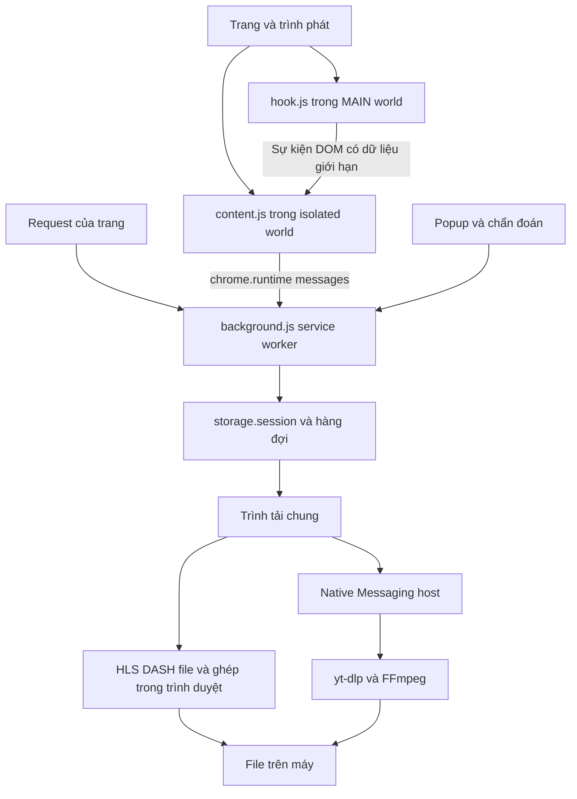
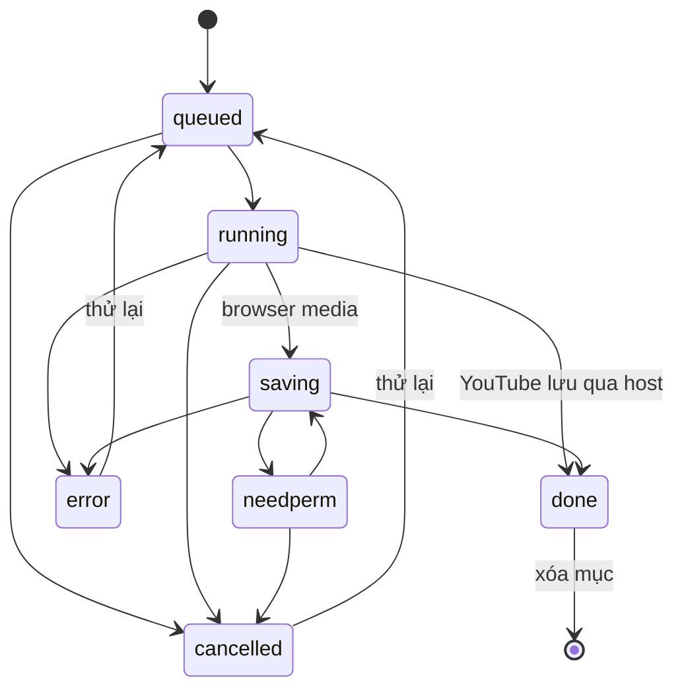

# Product Plan Video Catcher

**Phiên bản sản phẩm:** 1.7.0  
**Cập nhật:** 25/10/2026  
**Phạm vi:** sản phẩm hiện có, thiết kế kỹ thuật, cách xây dựng lại từ đầu và kế hoạch phát triển.

Video Catcher là tiện ích Chrome/Edge giúp người dùng tìm nguồn video trên trang, chọn chất lượng, tải và ghép thành file có thể phát trên máy. HLS/DASH/file thông thường được xử lý trong trình duyệt. YouTube tải được ngay trong trình duyệt (thu dữ liệu của trình phát YouTube, tối đa 1080p) hoặc qua chương trình hỗ trợ cục bộ nếu đã cài (tới 4K). Mọi loại tác vụ tải dùng chung một Trình tải.

Phiên bản trong `manifest.json` là mốc phát hành chính thức; tên thư mục chỉ để nhận biết. Các mục **Hiện có** bên dưới mô tả mã đã triển khai. Các mục trong **Lộ trình phát triển** là công việc dự kiến.

## 1 Mục tiêu sản phẩm

### Người dùng và nhu cầu

Người dùng cần lưu video được phép tải mà không phải tự tìm URL, đọc manifest, tải hàng trăm đoạn hoặc ghép hình và tiếng bằng lệnh thủ công. Người phát triển cần một công cụ chẩn đoán được những trường hợp khó như iframe, MediaSource, playlist tạo trong trang và nguồn bị gán sai loại nội dung.

### Kết quả cần đạt

1. Từ trang đang xem, người dùng nhận ra nguồn phù hợp với video chính.
2. Chất lượng, thời lượng và trạng thái tải được thể hiện rõ; dung lượng ước tính có ký hiệu riêng.
3. File tải xong có hình và tiếng nếu nguồn cho phép ghép và các track tương thích.
4. Khi không tải được, giao diện nêu nguyên nhân hoặc bước tiếp theo thay vì đưa ra nguồn giả.
5. Các thao tác tải, hủy, thử lại, mở thư mục và xóa mục tải có hành vi nhất quán.

### Giới hạn phạm vi

- Không xây máy chủ tải video, tài khoản người dùng hay dịch vụ lưu trữ đám mây.
- Không hỗ trợ vượt DRM, paywall, đăng nhập hoặc xác minh tài khoản.
- Không cam kết tải mọi video trên mọi website. Khả năng tải phụ thuộc định dạng, quyền truy cập và phản hồi nguồn.
- Không xem đuôi URL là bằng chứng đầy đủ về loại dữ liệu.

## 2 Nguyên tắc giao diện đã chốt

| Quyết định | Hành vi sản phẩm |
| --- | --- |
| Nút ở ngoài khung video | Ưu tiên bên phải, rồi trên/dưới/trái; không đặt đè lên hình hoặc thanh điều khiển. |
| Một Trình tải chung | HLS, DASH, file và YouTube cùng hàng đợi, trong **một cửa sổ Trình tải nhỏ** (540×600, như hộp thoại tải của IDM); bấm tải không mở thêm cửa sổ tiến trình riêng. YouTube trong trình duyệt mở một tab thu tắt tiếng, trả người dùng về tab cũ và tự đóng tab thu khi xong. |
| Chọn chất lượng tại nguồn | Menu trên trang và popup hiển thị lựa chọn chất lượng. |
| Không bắt người dùng chờ danh sách | YouTube: danh sách đủ mọi mức video có, đọc trước khi trang video tải xong; không hiện danh sách tạm rồi đổi. |
| Không có nút Dùng Downloads | Đã bỏ nút này. Chưa chọn thư mục riêng thì Downloads vẫn là nơi lưu mặc định của tải trong trình duyệt. |
| Xóa mục không xóa file | Xóa và Dọn danh sách chỉ thay đổi danh sách tác vụ (và lịch sử), xóa file tạm của mục đó; không xóa file đã lưu. |
| Material 3, hai nhóm màu | Mọi màn hình theo Material 3; màu chỉ gồm trung tính (trắng/đen/xám) và màu giao diện đỏ (#D32F2F sáng / #FF6B66 tối); trạng thái phân biệt bằng icon và chữ, lỗi dùng màu giao diện. Icon nét SVG, không emoji. |
| Trình tải tối giản | Một thanh trên (nơi lưu · số video/lần · Dọn); mỗi mục hiện tên file một lần (sửa trực tiếp trên tên tới khi lưu, sau khi lưu là tên thật trên đĩa); xong chỉ còn "✔ Đã lưu · thời lượng · dung lượng" + Mở thư mục/Xóa; không hiện nhãn "Gốc"; Mở thư mục chỉ khi đã có file; lỗi chỉ hiện ô chẩn đoán (không lặp dòng "Lỗi: …"), Sao chép chi tiết nằm trong Chi tiết kỹ thuật. |
| Lỗi phải nói được việc tiếp theo | Thẻ lỗi nêu nguyên nhân và đưa nút hành động phù hợp thay vì chỉ hiện thông báo kỹ thuật. |
| Nguồn chưa sẵn sàng phải nói rõ | Playlist bọc mã hóa chưa xử lý không được hiển thị thành LIVE hoặc URL tải giả. |
| Có nút không đồng nghĩa tải được | Video chưa phát vẫn có thể hiện nút; menu hướng dẫn phát video để bắt nguồn. DRM vẫn nằm ngoài phạm vi tải. |

Nếu không còn khoảng trống ngoài video, nút có thể ẩn. Với iframe trình phát phù hợp, trang cha có thể đặt nút bên ngoài toàn bộ iframe. Popup trên thanh công cụ là lối truy cập dự phòng.

## 3 Danh mục tính năng hiện có

### Phát hiện video và nguồn

| Mã | Tính năng | Cách triển khai chính |
| --- | --- | --- |
| F01 | Tìm thẻ video | Quét DOM, iframe cùng nguồn phù hợp và Shadow DOM mở/đóng khi API trình duyệt cho phép. |
| F02 | Nhận diện iframe trình phát | Xét thuộc tính fullscreen, URL/tiêu đề player/embed; loại khung yêu cầu camera/microphone. |
| F03 | Nút ngoài video | Tính hình chữ nhật video/player, chọn vị trí ngoài khung và cập nhật khi cuộn/đổi kích thước. Menu được đặt trong màn hình ngay khi mở (mở lên trên khi nút sát mép dưới, ví dụ trình phát 100vh của VieON) và đặt lại khi nội dung thay đổi. |
| F04 | Video tải muộn | Không yêu cầu thẻ video phải có `src` hoặc dữ liệu phát mới hiện nút. Có hướng dẫn bấm phát khi chưa có nguồn. |
| F05 | Bắt nguồn từ mạng | `webRequest` đọc URL, Content-Type, Content-Length và Content-Range; lưu nguồn theo tab. |
| F06 | Bắt playlist trong trang | Quan sát Fetch text/ArrayBuffer/stream, XHR text/ArrayBuffer/Blob, `URL.createObjectURL` và sự kiện hls.js. |
| F07 | Bắt playlist sau xử lý của player | Quan sát kết quả thành công của lời gọi AES-GCM trong trang, ghép với ngữ cảnh phản hồi bằng IV; không xuất khóa. |
| F08 | Nhận dữ liệu gán sai loại | Dò nội dung HLS/MPD dù nhãn là ảnh, JSON, octet-stream hoặc PDF; không tự coi mọi PDF là video. |
| F09 | Loại nguồn phụ và trùng | Gom clip xem trước/quảng cáo ngắn, ẩn playlist con đã thuộc master, gom tiếng/phụ đề dưới nguồn tổng. |

Các request `.pdf` trong Network có thể là phân đoạn video. Khi thấy dấu đồng bộ MPEG-TS, tiện ích đánh dấu đoạn đã nhận diện để tránh dò lại như playlist. Không chặn request đang phục vụ phát video.

### Tải và xử lý media

| Mã | Tính năng | Phạm vi |
| --- | --- | --- |
| F10 | File media thông thường | Video/audio dạng file; có chia khúc bằng Range khi nguồn hỗ trợ và phương án tải bằng Chrome. |
| F11 | HLS nhiều chất lượng | Master/media playlist, audio group, byte range, init segment, thời lượng, trạng thái VOD/live. |
| F12 | HLS AES-128 | Tải khóa theo luồng thông thường, tạo IV theo metadata/sequence và giải mã AES-CBC trong trình duyệt. |
| F13 | DASH | SegmentTemplate, SegmentTimeline, SegmentList, SegmentBase/BaseURL và nhiều Period. |
| F14 | Ghép hình và tiếng | MPEG-TS chuyển sang fMP4 bằng mux.js; ghép các track fMP4 bằng thư viện nội bộ. |
| F15 | Phương án dự phòng định dạng | Có thể lưu TS gốc khi chuyển HLS thất bại; WebM tách track có thể lưu riêng kèm lệnh ghép FFmpeg. |
| F16 | HLS trực tiếp | Nạp lại playlist theo chu kỳ, tải đoạn mới và Dừng & lưu. Chưa hỗ trợ livestream DASH/YouTube. |
| F17 | Ghi video | `captureStream` và `MediaRecorder`; ghi từ hiện tại hoặc từ đầu khi có thể, tự chia phần khi nguồn đổi. |
| F18 | YouTube | Hai chế độ. **Trong trình duyệt** (mặc định khi chưa có helper): tab thu ép H.264/AAC, quan sát `appendBuffer`, ghép box MP4 bị cắt, bỏ đoạn trùng, phát nhanh/tua để tải hết rồi ghép MP4 trong Trình tải, tối đa 1080p. **Helper** yt-dlp/FFmpeg trên Windows x64: tới 4K. Menu/popup hiện ngay mọi mức MP4 video có (đọc từ trang, đọc trước khi trang tải xong) kèm dung lượng ước tính, codec, thời lượng. |

### Quản lý tác vụ và lưu file

| Mã | Tính năng | Hành vi |
| --- | --- | --- |
| F19 | Hàng đợi chung | 1–5 tác vụ chạy đồng thời (mặc định 5, người dùng chọn và được lưu); mục thêm trước chạy trước. Các lượt HLS/DASH/file dùng chung tối đa 16 request mạng. YouTube trong trình duyệt tối đa 2 lượt cùng lúc (mỗi lượt một tab). |
| F20 | Tiến trình | Phần trăm, số đoạn, byte, tốc độ, thời gian còn lại và trạng thái lưu khi có đủ metadata. |
| F21 | Hủy và thử lại | Dừng yêu cầu bằng AbortController hoặc Native Messaging; có bảo vệ kết quả thử cũ không ghi đè lượt YouTube mới. |
| F22 | Xóa và dọn danh sách | Xóa mục chờ/đã kết thúc hoặc cần quyền lưu; không cho xóa giữa lúc đang ghi file. |
| F23 | Mở thư mục | File Chrome đã lưu mở vị trí file; thư mục tự chọn: helper tìm đường dẫn thật từ tên thư mục + tên/dung lượng file (`reveal`, `youtube/locate.cjs`: thư mục đã nhớ → vị trí thường gặp → quét có giới hạn độ sâu/thời gian), mở Explorer chọn sẵn file và nhớ đường dẫn trong storage.local; không có helper thì báo file nằm ở thư mục nào; YouTube mở File Explorer và chọn sẵn file vừa tải (`explorer /select`, không mở ẩn). |
| F24 | Chọn nơi lưu | File System Access, Downloads/thư mục con, hỏi nơi lưu mỗi lần và cấp lại quyền ghi. |
| F25 | Đặt tên và tránh ghi đè | Đổi tên từng mục HLS/DASH/file/YouTube trong trình duyệt trước khi lưu; tên được làm sạch, thêm số khi trùng trong thư mục tự chọn kể cả sau 999 mục hoặc khi trùng thư mục. Downloads hiện tên thật Chrome đã lưu. YouTube qua helper giữ tên kèm ID. |
| F31 | Ghi xuống đĩa | Dữ liệu media ghi dần vào file tạm trong Origin Private File System (Spool), ghi theo vị trí cho khúc song song; RAM chỉ giữ moof. Kết quả ghép từ lát File trên đĩa. File tạm giữ Web Lock, dọn khi xong/hủy/xóa và khi mở lại Trình tải. Không có OPFS thì giữ Blob như cũ. |
| F32 | Chẩn đoán trên thẻ lỗi | `lib/errors.js` phân loại HTTP 401/403/404/410/429/5xx, mạng/CORS, timeout, Range, DRM, playlist trong trang, ghép, ổ đĩa đầy, quyền lưu, lỗi lưu (giữ dữ liệu để Lưu lại), helper và tab thu YouTube; nút Mở trang nguồn, Lưu lại, Lưu vào Downloads, Cấp quyền ghi, Tải trong trình duyệt, Tải 1 video mỗi lần, Sao chép chi tiết. |
| F33 | Lịch sử tải | Lưu tối đa 200 mục trong IndexedDB (kể cả handle thư mục, tên file); khôi phục khi mở Trình tải. Mục dở dang hiện "bị gián đoạn" để Thử lại; phần tải dở không resume. |

### Cài đặt và chẩn đoán

| Mã | Tính năng | Hành vi |
| --- | --- | --- |
| F26 | Popup tiện ích | Ưu tiên tải: thẻ theo nguồn (YouTube/HLS/DASH/file) với tiêu đề video và hàng chất lượng (mức · codec/bitrate · dung lượng), bấm hàng để thêm vào Trình tải; menu ⋯ sao chép link/lệnh FFmpeg; clip xem trước/quảng cáo gom riêng. Ghi hình theo frame trong phần gập (tự mở khi đang ghi hoặc không có nguồn tải). Chân: công tắc nút trên video, nơi lưu. Thông báo dạng toast; sáng/tối theo hệ thống. |
| F27 | Điều khiển nút nổi | Bật/tắt chung (⚙ Cài đặt), bật/tắt theo trang đang xem (chân popup, chip "Ẩn trên trang này" trong menu), danh sách các trang đang ẩn với Hiện lại; lưu `overlay`/`overlayOff` trong storage.local, áp dụng ngay cho tab đang mở. |
| F34 | Nút Tải trên YouTube | Trang `/watch`: nút ⬇ `ytp-button` đầu `.ytp-right-controls` (thấy ở mọi chế độ kể cả rạp hát/toàn màn hình, menu kiểu trình phát nền mờ) và nút ⬇ Tải (shadow DOM, kiểu nút YouTube, theo `html[dark]`) sau `#top-level-buttons-computed`; kiểm tra lại mỗi 1,5 giây và khi `yt-navigate-finish`. Bấm mở cùng menu chọn chất lượng neo dưới nút; không hiện nút nổi cho `#movie_player` khi nút này có mặt. Tắt theo cài đặt nút trên video. |
| F28 | Chẩn đoán | Tóm tắt dễ đọc theo mức ✓ ổn / ! cần làm thêm / ✕ không tải được / i chỉ để biết, kèm việc nên làm (khung quảng cáo/khung trống không phản hồi là bình thường). Phần **Chi tiết kỹ thuật** giữ phiên bản từng frame, nguồn mạng, playlist, mẫu nội dung, cấu trúc đã phân tích và số segment PDF. Ẩn trên YouTube. |
| F29 | Kiểm tra đoạn nguồn | Chế độ chẩn đoán nâng cao đọc có giới hạn đoạn đầu, trả HTTP status và số byte; không tương đương tải xong toàn bộ video. |
| F30 | Cài helper YouTube (không bắt buộc) | `setup-youtube.cmd` chạy PowerShell với `-ExecutionPolicy Bypass` cho riêng lần cài; tải công cụ, kiểm tra SHA-256, tìm ID tiện ích và đăng ký Native Messaging trong HKCU. |

## 4 Luồng sử dụng

### Video HLS hoặc DASH

1. Người dùng phát video và mở nút tải hoặc popup.
2. Tiện ích thu nguồn từ tab, đọc manifest và nhóm các lựa chọn chất lượng.
3. Người dùng chọn một lựa chọn hợp lệ; background đưa Job vào storage.session và hiện cửa sổ Trình tải nhỏ (mở mới hoặc đưa cửa sổ đang có lên).
4. Trình tải nhận tác vụ, tải các đoạn, giải mã thông thường khi cần và ghép track.
5. Kết quả được lưu vào đích đang chọn; card chuyển sang Đã lưu và cung cấp Mở thư mục/Xóa.

### Playlist bọc mã hóa trong trang

1. Hook nhận bản phản hồi có `#ENC-AESGCM` hoặc `#EXT-X-B65`.
2. Bộ đọc từ chối dùng các dòng bọc làm URL phân đoạn; không gắn nhãn LIVE giả.
3. Trình phát tự xử lý dữ liệu để phát video. Hook quan sát kết quả plaintext, giữ URL nền và chuyển cho extension.
4. Background ưu tiên bản đã xử lý, giữ Referer của iframe và cập nhật thông tin chất lượng.
5. Chỉ bật mức chất lượng đã có playlist hình/tiếng phù hợp. Muốn mức khác, người dùng chọn mức đó trong trình phát, cho phát vài giây rồi mở lại menu.

### YouTube

1. Chuẩn hóa URL thành một video duy nhất, bỏ tham số playlist/radio không cần thiết.
2. Content script gửi `vc:youtubePrefetch` ngay khi trang video tải xong, mỗi lần YouTube chuyển video (`yt-navigate-finish`) và khi rê chuột lên video. Background làm song song hai việc:
   - Đọc trang watch (~1–2 giây, cache 2 phút), lấy `ytInitialPlayerResponse` và tính hai danh sách: **cho helper**, mọi mức có bản MP4, mỗi mức ưu tiên H.264 rồi fps cao rồi bitrate (giống bộ lọc định dạng của lệnh tải), dung lượng = `contentLength` hình + tiếng M4A tốt nhất; **trong trình duyệt**, các mức H.264 ≤1080p.
   - Gửi `hello` tới helper (timeout 8 giây; nhớ 5 phút nếu có, 30 giây nếu không).
   Helper sẵn sàng → engine `native` với danh sách cho helper. Không đọc được trang → mới gọi `inspect` (yt-dlp) làm dự phòng, cache 5 phút. Helper không chạy → engine `browser` kèm lý do (`nativeError`) hiện trong menu.
3. Menu/popup hiện chất lượng. Khi người dùng chọn, một Job `youtube` (engine `native` hoặc `browser`) vào hàng đợi chung.
4. **Helper:** Manager mở kết nối native riêng; host chạy yt-dlp với đối số cố định, FFmpeg ghép MP4, host trả đường dẫn và kích thước. Thanh tiến trình thể hiện luồng hiện tại.
5. **Trong trình duyệt:** Manager xin background mở tab `watch?v=…#vc-capture=<job>.<token>.<chiều cao>` ở phía trước (tránh Chrome hoãn media ở tab nền), tắt tiếng tab. `lib/yt-capture.js` (MAIN world, chỉ chạy khi có hash này) ép H.264/AAC, chọn chất lượng, ghép box từ `appendBuffer`, bỏ fragment trùng theo `tfdt`, chỉ chuyển dữ liệu của MediaSource có thời lượng khớp video (bỏ quảng cáo), phát 2x và tua tới cuối vùng đệm, tự tua về lỗ hổng. Content script chuyển init/fragment (base64) qua cổng `vc-yt:<job>:<token>`; khi có fragment đầu tiên, background trả người dùng về tab cũ. Manager ghi vào Spool, ghép MP4 và lưu như HLS, rồi đóng tab thu.

### Ghi hình

Người dùng chọn thẻ video thật trong menu/popup, chọn ghi hiện tại hoặc từ đầu. Extension tạo MediaStream và MediaRecorder, hiển thị thời gian ghi và Dừng & lưu. Khi nguồn đổi, phiên ghi có thể lưu phần hiện tại rồi tiếp tục phần mới. Ghi diễn ra theo thời gian thực và phụ thuộc quyền/khả năng capture của trình phát.

### Khi chỉ thấy quảng cáo hoặc không có nguồn

Kiểm tra phiên bản, tải lại trang sau khi cập nhật tiện ích, cho video chính phát rồi mở lại menu. Nếu chưa có nguồn, mở Chẩn đoán để phân biệt: không có content script, video nằm trong iframe, chưa có playlist đã xử lý, phản hồi HTTP lỗi, hoặc định dạng/DRM không hỗ trợ. Không kết luận DRM chỉ vì nguồn là `blob:` hoặc chưa có link tải.

## 5 Kiến trúc hệ thống



### Tách trách nhiệm

| Thành phần | Trách nhiệm |
| --- | --- |
| MAIN world | Quan sát dữ liệu mà player đọc/xử lý; không tạo UI tải hay gọi Chrome API của content script. |
| Isolated world | Tìm video, đặt nút, dựng menu, ghi hình và chuyển sự kiện đã kiểm tra sang background. |
| Service worker | Lưu nguồn theo tab, đọc manifest, chuẩn bị Referer, cache metadata và xếp Job. |
| Manager | Chạy tác vụ dài, quản lý tiến trình, ghi file tạm, ghép/lưu file, lịch sử, chẩn đoán lỗi, gọi helper hoặc điều phối tab thu YouTube. |
| Native host | Thực thi tập thao tác hẹp trên máy; không nhận lệnh shell tùy ý từ trang web. |

Service worker có thể bị dừng bởi trình duyệt nên dữ liệu nguồn cần được khôi phục từ storage.session. Manager giữ trạng thái tác vụ trong phiên của cửa sổ tải, dữ liệu media trong file tạm trên đĩa và lịch sử trong IndexedDB; phần tải dở không resume sau khi đóng cửa sổ.

## 6 Cấu trúc mã nguồn

| Tệp hoặc thư mục | Vai trò |
| --- | --- |
| `manifest.json`, `icons/` | Manifest V3, quyền, khai báo scripts, popup và biểu tượng. |
| `background.js` | Network capture, nguồn theo tab, manifest, cache, Referer, hàng đợi và mở manager. |
| `hook.js` | Fetch/XHR/Blob/hls.js, kết quả xử lý AES-GCM và phân loại TS mang đuôi PDF. |
| `lib/yt-capture.js` | Thu YouTube trong tab thu (MAIN world); không làm gì ở tab khác. |
| `lib/errors.js` | Phân loại lỗi cho thẻ tải. |
| `content.js` | DOM video/iframe/Shadow DOM, nút, menu, MediaRecorder và message bridge. |
| `manager.html`, `manager.css`, `manager.js` | UI tải, Job, scheduler, networking, mux và nơi lưu. |
| `popup.html`, `popup.css`, `popup.js` | Nguồn và thao tác trên tab hiện tại; quét/khôi phục scripts khi cần. |
| `diagnostics.html`, `diagnostics.js` | Báo cáo nguồn, frame, manifest và chế độ đọc thử đầu luồng. |
| `lib/m3u8.js` | HLS master/media, audio/subtitle groups, key, map, byte range, thời lượng và chặn wrapper chưa xử lý. |
| `lib/mpd.js` | DASH, representation, nhiều Period và mô tả segment. |
| `lib/fmp4.js` | Đọc và ghép track MP4 phân mảnh. |
| `lib/mux-mp4.min.js` | mux.js 7.0.3 dùng cho transmux MPEG-TS. |
| `lib/youtube.js` | Chuẩn hóa URL YouTube; đọc từ trang watch mọi mức MP4 cho helper (`downloaderOptions`) và các mức H.264 ≤1080p cho chế độ trong trình duyệt (`browserOptions`), kèm dung lượng. |
| `lib/native-youtube.js` | Native client dùng chung cho background/manager. |
| `lib/position.js`, `lib/frames.js` | Tính vị trí nút ngoài player, vị trí menu và nhận diện iframe phù hợp. |
| `setup-youtube.cmd`, `youtube/setup-youtube.ps1` | Cài công cụ và đăng ký native host. |
| `youtube/native-host.cjs`, `youtube/download.cjs` | Host và CLI dùng cùng giao thức native. |
| `.gitignore` | Loại công cụ tải về, cấu hình sinh riêng từng máy và video tải xuống khỏi Git nếu dùng Git. |

## 7 Dữ liệu và giao tiếp

### Các nhóm dữ liệu

| Nhóm | Trường chính | Nơi giữ |
| --- | --- | --- |
| Nguồn media | URL, key chuẩn hóa, kind, Content-Type, size, tên, thời điểm, Referer | Map theo tab và storage.session. |
| Playlist thu trong trang | kind, text, base, `playerDecoded`, thời điểm | Bộ nhớ background và storage.session. |
| Candidate | URL, Content-Type, pattern, checked | Bộ nhớ service worker. |
| Job | id, kind, URL hình/tiếng, title, quality, duration, size/estimate, tabId, Referer | storage.session trước khi nhận; đối tượng Job trong manager sau khi nhận. |
| Cấu hình | Bật nút, danh sách website ẩn, thư mục con, hỏi nơi lưu | storage.local. |
| Directory handle | Handle thư mục đã chọn, không phải đường dẫn hệ điều hành dạng chuỗi | IndexedDB. |
| Cấu hình YouTube | Thư mục đích, launcher, manifest host, allowed origins | File cục bộ sinh bởi trình cài và Registry HKCU. |

### Message chính

| Message | Mục đích |
| --- | --- |
| `vc:list` | Video và trạng thái ghi trong một frame. |
| `vc:sources` | Nguồn đã phân tích thành file/stream/chất lượng. |
| `vc:inline`, `vc:manifestText` | Gửi hoặc đọc bản manifest thu được trong trang. |
| `vc:segment` | Đánh dấu URL PDF đã có chữ ký segment TS. |
| `vc:startHls` | Đưa tác vụ HLS/DASH/file vào hàng đợi. |
| `vc:youtubeInfo`, `vc:youtube` | Đọc chất lượng/dung lượng và xếp tác vụ YouTube (engine native/browser). |
| `vc:youtubePrefetch` | Đọc trước danh sách chất lượng khi trang video tải xong/chuyển video. |
| `vc:ytCaptureStart`, `vc:ytCaptureStop` | Chỉ Trình tải gọi: mở/đóng tab thu YouTube. |
| `vc:ytCaptureStarted`, `vc:ytCaptureEnded` | Tab thu báo đã có dữ liệu (trả người dùng về tab cũ) hoặc Trình tải đã ngắt (tự đóng). |
| `vc:referer` | Chuẩn bị header cho request của extension. |
| `vc:record`, `vc:stop`, `vc:saveRecording` | Điều khiển/lưu phiên ghi. |
| `vc:diagnostics`, `vc:probeSource` | Báo cáo và kiểm tra nguồn có giới hạn. |

### Trạng thái Job



Khi browser tải xong dữ liệu nhưng thiếu quyền ghi, Job có thể chuyển trực tiếp từ bước xử lý sang `needperm` trước khi bắt đầu ghi. Xóa mục không gọi chức năng xóa file trên đĩa.

## 8 Chiến lược bắt nguồn

1. Dùng URL và Content-Type để nhận diện nhanh HLS/DASH/file.
2. Dùng Content-Range để lấy tổng kích thước khi phản hồi chỉ là một phần của file.
3. Giữ candidate cho các phản hồi chưa rõ và đọc giới hạn phần đầu khi cần.
4. Dùng hook trong trang để lấy dữ liệu mà background không thể tự tái tạo chỉ bằng GET URL.
5. Với AES-GCM wrapper, giữ bản chưa xử lý để chẩn đoán, chờ bản player đã xử lý và cập nhật ngay khi có bản hợp lệ.
6. Từ master playlist, ghép chất lượng với audio group; ẩn các playlist phụ đã thuộc master.
7. Giữ URL nền để resolve segment tương đối và Referer của frame phát thực tế.

Không dùng chuỗi base64 trong wrapper làm đường dẫn media. Không gắn nhãn live chỉ dựa trên việc một chuỗi bắt đầu bằng `#EXTM3U`: parser phải nhận được cấu trúc HLS phù hợp. Không xuất hoặc lưu khóa Web Crypto trong đường quan sát playlist đã giải mã của player.

## 9 Thiết kế bộ tải

### Thông số hiện tại

| Tham số | Giá trị |
| --- | --- |
| Tác vụ đồng thời | 1–5, mặc định 5 |
| Ngân sách request mạng dùng chung mọi tác vụ | 16 |
| Đoạn HLS/DASH đồng thời trong bộ tải có thứ tự | 16 |
| Giới hạn tải trước so với đoạn chờ ghép | 40 |
| Kích thước chunk file | 4 MiB |
| Chunk file đồng thời | 8 |
| Timeout kết nối / không nhận dữ liệu | 30 giây / 15 giây, sau đó thử lại |
| Số lần thử network tối đa thông thường | 5; một số mã lỗi dừng sớm |

Worker tải song song nhưng sink nhận dữ liệu theo đúng thứ tự. Khi lỗi xảy ra, tiến trình báo lỗi và cho thử lại; AbortController được truyền xuống các request để hủy. Giới hạn tải trước và Spool giữ RAM gần như không đổi theo độ dài video: dữ liệu đã nhận được ghi xuống file tạm (tối đa 32 MiB chờ ghi trước khi bộ tải phải đợi đĩa), RAM chỉ giữ moof. Lúc lưu cần chỗ trống khoảng gấp đôi dung lượng video.

### Xử lý định dạng

- TS/AAC phù hợp đi qua mux.js để tạo track MP4 phân mảnh.
- fMP4 có init segment và media segment được phân tích, gom track và ghép qua `VCFMP4`.
- Hình/tiếng tách riêng cần giữ đúng metadata và thời lượng khi mux.
- Dữ liệu có tiền tố giả được dò điểm đồng bộ TS trước khi transmux; tài liệu PDF thật không được mặc định coi là TS.
- Nếu ghép WebM trong browser không khả dụng, kết quả có thể là hai file và lệnh FFmpeg để người dùng ghép.

## 10 Thiết kế helper YouTube (không bắt buộc)

### Giao thức

Trình duyệt kết nối host `com.videocatcher.youtube`. Mỗi thông điệp là JSON UTF-8 có tiền tố 4 byte độ dài theo Native Messaging. Host nhận các thao tác hẹp: `hello`, `inspect`, `download`, `cancel`, `openFolder`, `reveal`; phản hồi gồm `ready`, `info`, `progress`, `done`, `cancelled`, `folderOpened`, `error`. `hello` → `ready` (kèm thư mục lưu) dùng để biết helper có chạy được, thay cho `inspect` khi đọc được danh sách từ trang. `openFolder` nhận đường dẫn file đã lưu để Explorer chọn sẵn file đó (chỉ khi file nằm trong thư mục lưu). Host ghi nhật ký vào `youtube/host.log`.

Host kiểm tra URL, giới hạn giá trị chất lượng, truyền đối số bằng `spawn` với `shell: false`, bỏ cấu hình/plugin mặc định không mong muốn của yt-dlp và không nhận đối số shell tùy ý từ nội dung trang. Kết nối được đóng sau kết quả cuối; mỗi lượt tải manager có ngữ cảnh riêng để kết quả cũ không ghi đè lượt thử mới.

### Công cụ và nơi lưu

yt-dlp lấy thông tin/tải media; Node.js cung cấp runtime cho host và JavaScript runtime cho yt-dlp; FFmpeg ghép hình và tiếng thành MP4. Bộ tải ưu tiên tổ hợp MP4 + M4A theo mức chất lượng đã chọn, ưu tiên định dạng tải trực tiếp qua HTTPS (không HLS/DASH) để dung lượng ước tính khớp file tải, không chủ động encode lại video.

Mặc định file YouTube nằm trong `downloads` của dự án. Đổi đích bằng tham số `-DownloadDir` của trình cài. Đích này độc lập với directory handle của bộ tải browser. Các file `.part` có thể được giữ để tiếp tục khi thử lại.

## 11 Quyền và dữ liệu người dùng

| Quyền | Lý do dùng |
| --- | --- |
| `downloads` | Lưu file và mở vị trí file/Downloads. |
| `nativeMessaging` | Kết nối helper YouTube. |
| `webRequest` | Quan sát request và metadata media. |
| `webNavigation` | Liệt kê frame, xử lý điều hướng. |
| `storage` | Cấu hình, nguồn theo phiên, hàng đợi. |
| `scripting` | Khôi phục content script ở frame chưa có script khi quét lại. |
| `declarativeNetRequestWithHostAccess` | Đặt Referer cho request extension tới nguồn media. |
| Host access `<all_urls>` | Hỗ trợ website/frame/CDN khác nhau trong phạm vi trình duyệt cho phép. |

Nội dung trang và sự kiện DOM được coi là dữ liệu đầu vào, không phải lệnh đáng tin để thực thi trên máy. Kiểm tra kiểu, giới hạn độ dài, loại message và URL trước khi sử dụng. Báo cáo chẩn đoán hiển thị cục bộ và không tự gửi ra dịch vụ; báo cáo có thể chứa URL nguồn cần xử lý cẩn thận khi người dùng chủ động chia sẻ.

## 12 Cách xây dựng dự án từ đầu

### Bước 1 Khởi tạo nền tảng

Tạo extension Manifest V3 với JavaScript, HTML và CSS thuần. Khai báo service worker, popup và content scripts. Chưa cần framework, npm package hoặc bước bundle để chạy phần extension hiện tại. Thêm biểu tượng, mô tả và hướng dẫn Load unpacked.

**Hoàn thành khi:** tiện ích cài được trên Chrome/Edge, popup mở được và content script gửi được một message về background.

### Bước 2 Tìm video và đặt nút

Viết hàm tìm video, đọc hình chữ nhật hiển thị, lọc camera và tính vị trí ngoài khung. Dựng nút/menu bằng DOM trong Shadow DOM để hạn chế xung đột CSS. Bổ sung pointer capture, video chưa có nguồn, iframe và Shadow DOM.

**Hoàn thành khi:** nút xuất hiện trên các video mẫu, không che player và không tự phát sinh thao tác tải.

### Bước 3 Thu và lưu nguồn

Đăng ký network observer, chuẩn hóa nguồn trùng, quản lý nguồn theo tab và khôi phục trạng thái phiên. Xóa nguồn cũ theo điều hướng/thời điểm để không trộn hai video khác trang.

**Hoàn thành khi:** file MP4 và manifest mẫu hiện đúng trong popup sau khi trang phát video.

### Bước 4 Viết parser HLS và DASH

Tách parser thành thư viện dùng chung cho worker và manager. Xử lý URL tương đối, biến thể chất lượng, audio group, key/map/range và cấu trúc segment DASH. Viết fixture cho dữ liệu chuẩn, dữ liệu thiếu và wrapper không phải playlist có thể tải.

**Hoàn thành khi:** parser trả đúng cấu trúc có thể kiểm tra và từ chối dữ liệu không được hỗ trợ.

### Bước 5 Dựng hàng đợi và Job

Định nghĩa Job, các trạng thái, thao tác Hủy/Thử lại/Xóa/Mở thư mục và scheduler. Dùng storage.session để chuyển tác vụ từ background tới manager, Web Locks để hạn chế hai manager nhận cùng một tác vụ.

**Hoàn thành khi:** nhiều tác vụ vào cùng Trình tải, giữ giới hạn đồng thời và chuyển trạng thái rõ ràng.

### Bước 6 Tải dữ liệu và xử lý lỗi

Viết fetch có AbortSignal, retry, Range, theo dõi byte và tải segment có thứ tự. Tính tốc độ/ETA từ dữ liệu thực. Xử lý 403/404/410 và nguồn bỏ qua Range; không báo 100% thành công trước khi lưu file kết thúc.

**Hoàn thành khi:** file tải đúng byte và hủy không tiếp tục ghi kết quả ngoài ý muốn.

### Bước 7 Ghép media và lưu

Tích hợp mux.js, xử lý fMP4, track hình/tiếng và phương án TS/WebM dự phòng. Tách thao tác lưu Downloads với File System Access, ghi nhớ directory handle và cấp lại quyền. Giữ handle của lượt lưu để đổi đích giữa lúc tải không làm mở nhầm thư mục cũ.

**Hoàn thành khi:** file mẫu có hình/tiếng phát được và thao tác Xóa không xóa file đã lưu.

### Bước 8 Bổ sung ghi hình và livestream

Thêm MediaRecorder, lựa chọn MIME được hỗ trợ, ghi hiện tại/từ đầu, phát hiện đổi nguồn và chia phần. HLS live cần giữ sequence đã tải, đọc lại playlist và dừng/lưu theo thao tác người dùng.

**Hoàn thành khi:** bản ghi có thể dừng/lưu, live không tải lặp các đoạn đã nhận.

### Bước 9 Xử lý nguồn khó

Đưa hook vào MAIN world ở document_start. Quan sát dữ liệu bằng clone/đọc giới hạn, giữ nguyên kết quả Promise và hành vi native. Thêm cơ chế báo sẵn sàng/phát lại dữ liệu để không mất manifest khi listener content script khởi động sau. Bổ sung context AES-GCM, kiểm tra wrapper và nhận diện segment giả đuôi.

**Hoàn thành khi:** fixture mã hóa được thay bằng plaintext do player xử lý, không sinh LIVE giả hoặc URL base64 giả.

### Bước 10 Tích hợp YouTube

Viết bộ chuẩn hóa URL, Native Messaging client/host, trình cài công cụ và danh sách origin cho phép. Nối kết quả inspect vào menu/popup và đưa download vào Job chung. Kiểm tra hủy và thử lại khi message cũ tới muộn.

**Hoàn thành khi:** video công khai mẫu tải thành một MP4 có hình/tiếng, không mở tab YouTube riêng.

### Bước 11 Thêm chẩn đoán và kiểm thử

Hiển thị báo cáo theo tab/frame, thông tin manifest và phép probe có giới hạn. Dùng Node test runner với fixture mạng/DOM/native port. Tách kiểm tra tự động khỏi kiểm tra video thật để test không tự tải nội dung trên mạng.

**Hoàn thành khi:** lỗi nguồn có thể phân loại bằng dữ liệu thay vì chỉ dựa vào nhãn hoặc đuôi URL.

### Bước 12 Chuẩn bị phát hành

Kiểm tra manifest, script được tham chiếu, quyền, phiên bản và hướng dẫn. Loại file tải, `.part`, công cụ sinh riêng từng máy và cấu hình Registry/host mang ID cá nhân khỏi gói mã nguồn. Thử Load unpacked trên profile sạch và xác minh riêng helper Windows.

**Hoàn thành khi:** một người khác cài và chạy được theo README, đồng thời hiểu rõ đích lưu và giới hạn.

## 13 Lệnh vận hành và phát triển

Chạy trong thư mục gốc dự án:

```powershell
# Kiểm tra cú pháp khi sửa thành phần tương ứng
node --check background.js
node --check content.js
node --check hook.js
node --check manager.js
node --check popup.js

# Cài/cập nhật helper YouTube sau khi đã Load unpacked tiện ích
.\setup-youtube.cmd

# Chỉ định ID nếu không tự nhận diện được
.\setup-youtube.cmd -ExtensionId "ID_TIEN_ICH_32_KY_TU"

# Đổi đích lưu của YouTube
.\setup-youtube.cmd -DownloadDir "D:\Videos"

# Tải mẫu bằng cùng giao thức native
.\youtube\tools\node.exe .\youtube\download.cjs 'https://www.youtube.com/watch?v=4jjOH2FR6-E' 1080
```

Khi sửa extension, tải lại tiện ích trong trang quản lý extensions rồi tải lại tab nguồn. Mở lại manager nếu cần nhận mã mới, sau khi kết thúc các lượt đang chạy. Đổi đường dẫn dự án/ID tiện ích cần chạy lại trình cài helper.

## 14 Kiểm thử và tiêu chí nghiệm thu

### Kiểm tra tự động

Dự án không kèm bộ test tự động: các test đã được gỡ ngày 01/11/2026 để chỉ giữ mã nguồn và tài liệu. Bộ test cũ vẫn còn trong lịch sử git (`git checkout 19107d4 -- tests`).

### Bằng chứng kiểm tra trên nguồn thật

| Trường hợp | Kết quả đã xác minh | Phạm vi còn lại |
| --- | --- | --- |
| YouTube mẫu `4jjOH2FR6-E` (helper) | File MP4 1920×1080, H.264 + AAC, khoảng 253,91 giây đã tải và kiểm tra bằng ffprobe. | Không suy rộng thành bảo đảm cho mọi video YouTube. |
| YouTube helper, 1.7.0 | Tải `9bZkp7q19f0` 360p và một video 2160p (777,8 MB) qua helper; **Mở thư mục** mở File Explorer tại file vừa tải. | Đã kiểm tra trên máy Windows của người dùng. |
| Danh sách chất lượng từ trang, 1.7.0 | Video `TXTS3Tlq18g` (1:50:56): đọc trang ~1,7 giây, ra 2160p AV1 ~17,3 GB, 1440p AV1 ~8,3 GB, 1080p60 H.264 ~3,9 GB, 720p60 ~2,4 GB và các mức thấp hơn, khớp cách helper chọn định dạng. | Chưa xác nhận menu trên Chrome đã tải lại tiện ích. |
| YouTube mẫu `4jjOH2FR6-E` (trong trình duyệt, 1.7.0) | Bộ thu chạy trên trình phát YouTube thật (Chromium): khoảng 20 giây cho video 4:14, ghép ra MP4 1280×720 H.264 + AAC, 253,9 giây, 8,96 MB, phát và tua tới cuối được. Dung lượng ước tính 720p từ trang: 8,6 MB. | Kiểm tra trong trình duyệt tích hợp bằng cách nạp module thủ công; cần xác nhận toàn luồng (tab thu, chuyển tab, lưu) trên Chrome có cài tiện ích. |
| RoPhim Anh Là Nam Chính Đời Em tập 1 | Nhận 720p VOD, 598 đoạn, khoảng 59:45; probe đầu luồng hình/tiếng trả HTTP 200/206. | Chưa nghiệm thu tải/ghép toàn bộ tập phim dài. |
| Rou.video | Đã có phản hồi người dùng rằng xuất hiện Luồng → MP4 sau sửa phần bắt playlist. | Chưa có xác nhận file hoàn chỉnh trong lượt kiểm tra đó. |
| VieON Nhất Âu Xuân | Trình phát cao 100vh: nút chỉ đặt được sát mép dưới sau khi cuộn; menu cũ mở ra ngoài màn hình trong lúc dò nguồn. Bản 1.7.0 đặt menu ngay khi mở; dựng lại nút thật trên trang VieON cho thấy nút nhận click. | Cần người dùng xác nhận trên Chrome có cài tiện ích. Khi chưa cuộn, nút ẩn (không còn chỗ ngoài khung); dùng popup. Chưa xác định luồng có DRM hay không. |

### Điều kiện nghiệm thu mỗi tính năng tải

- Nút/menu có thể truy cập và không che điều khiển quan trọng.
- Nguồn chính có metadata hợp lý; quảng cáo, audio/subtitle và wrapper không được trình bày sai là video hoàn chỉnh.
- Đích lưu và trạng thái tác vụ khớp với kết quả thật trên đĩa.
- File phát được; khi có hai track phải kiểm tra cả hình lẫn tiếng và thời lượng.
- Hủy không tiếp tục lưu ngoài ý muốn; thử lại không nhận nhầm kết quả cũ.
- Xóa/Dọn danh sách không xóa file người dùng.
- Nguồn không hỗ trợ hiển thị lý do, không tạo vòng lặp request không kiểm soát.

## 15 Giới hạn và rủi ro hiện tại

| Vấn đề | Hệ quả |
| --- | --- |
| Cần chỗ trống trên ổ đĩa | File tạm + file lưu cần khoảng gấp đôi dung lượng video; thiếu chỗ báo "Ổ đĩa không đủ chỗ trống". |
| Không resume sau khi đóng Trình tải | Lịch sử giữ lại mục, nhưng phần tải dở phải tải lại từ đầu. |
| YouTube trong trình duyệt phụ thuộc trình phát | Tối đa 1080p H.264; tốc độ theo trình phát; YouTube đổi cách nạp MediaSource có thể làm hỏng bộ thu; quảng cáo làm chậm bắt đầu. |
| URL theo phiên có thể hết hạn | Có thể cần giữ tab nguồn mở, phát lại hoặc bắt nguồn mới khi thử lại. |
| Website thay SDK/định dạng | Cần fixture mới và kiểm tra lại hook/parser; không coi một bản sửa là hỗ trợ vĩnh viễn. |
| Playlist chỉ được xử lý ở chất lượng đang phát | Không bật tải mức khác cho tới khi player đã cung cấp bản hợp lệ. |
| DRM và nội dung trả phí | Không hỗ trợ vượt bảo vệ; có nút không bảo đảm tải được. |
| Livestream và WebM chưa đồng nhất | HLS live có hỗ trợ; DASH/YouTube live và một số cách ghép WebM chưa có đường tải hoàn chỉnh trong browser. |
| File System Access không cho đường dẫn OS | Mở thư mục tự chọn cần helper tìm file trên đĩa; trùng tên thư mục + tên file + dung lượng ở hai nơi thì có thể mở nơi tìm thấy trước; không có helper thì chỉ báo tên thư mục. |
| Header/CDN phụ thuộc ngữ cảnh | Referer đúng là cần thiết với một số nguồn; HTTP 403 cần xem URL/context thực tế, không tự coi là lỗi parser. |
| Helper riêng trên Windows | Helper (1440p/4K) chưa có cho macOS/Linux; chế độ trong trình duyệt dùng được trên mọi hệ điều hành chạy Chrome/Edge. |

## 16 Lộ trình phát triển dự kiến

Các hạng mục dưới đây **chưa được coi là tính năng đã hoàn thành**.

| Ưu tiên | Hạng mục | Điều kiện hoàn thành |
| --- | --- | --- |
| P0 | Nghiệm thu video dài từ đầu tới cuối | Có file đầy đủ, hình/tiếng đồng bộ, thời lượng đúng và báo cáo dung lượng RAM. |
| P0 | Xác nhận VieON và YouTube trong trình duyệt trên Chrome thật | Người dùng bấm được nút/menu trên VieON; YouTube trong trình duyệt tải xong video dài, chuyển tab không làm chậm bất thường. |
| P0 | Bộ fixture tương thích nguồn khó | Lưu mẫu đã loại token nhạy cảm cho wrapper, iframe, MIME sai và phản hồi hết hạn. |
| P1 | Đo RAM/đĩa với video lớn | Có số đo RAM tối đa và dung lượng file tạm cho video 1–2 giờ sau khi có Spool. |
| P1 | Resume sau khi đóng Trình tải | Giữ file tạm và vị trí đoạn đã tải để tiếp tục thay vì tải lại từ đầu. |
| P1 | Quản lý nơi lưu thống nhất | Người dùng hiểu đích của browser/native, đổi đích và mở thư mục nhất quán hơn. |
| P2 | Cải thiện audio/phụ đề | Chọn ngôn ngữ và tải phụ đề khi nguồn cho phép; kiểm tra metadata container. |
| P2 | Hỗ trợ nền tảng bổ sung | Native host/installer phù hợp cho macOS/Linux, kiểm thử riêng từng nền tảng. |
| P2 | Chuẩn hóa gói phát hành | Kiểm tra profile sạch, hướng dẫn nâng cấp/gỡ helper và thông tin phụ thuộc. |

## 17 Chỉ số đánh giá đề xuất

Chưa có hệ thống thu thập số liệu tự động hay telemetry trong phạm vi hiện tại. Khi đánh giá một bản phát hành, ghi kết quả cục bộ trên tập mẫu được phép sử dụng:

- Tỷ lệ trang có trình phát hợp lệ hiện được nút hoặc truy cập được qua popup.
- Tỷ lệ nguồn được phân loại đúng: VOD/live, hình/tiếng/phụ đề/quảng cáo, wrapper/playlist.
- Tỷ lệ file hoàn chỉnh phát được và có đủ track mong đợi.
- Thời gian từ chọn chất lượng đến bắt đầu nhận dữ liệu, tốc độ và RAM tối đa.
- Tỷ lệ hủy/thử lại thành công; số lượt phải nạp lại nguồn vì token hết hạn.
- Số lỗi được phân loại rõ thay vì thông báo chung.

Mục tiêu định lượng nên được đặt sau khi có bộ mẫu và số đo nền, tránh dùng một website hoặc một video để đại diện toàn sản phẩm.

## 18 Cách duy trì kế hoạch

Khi thay đổi tính năng, cập nhật phiên bản, danh mục hiện có, giới hạn và tiêu chí kiểm tra trong file này. Giữ README tập trung vào cài đặt/cách dùng. Chỉ chuyển một hạng mục từ lộ trình sang hiện có sau khi mã và bằng chứng kiểm tra tương ứng đã sẵn sàng.

Tài liệu không chứa khóa giải mã, cookie, token CDN theo phiên hoặc đường dẫn cá nhân sinh bởi trình cài. Dữ liệu mẫu phục vụ kiểm thử cần được làm sạch trước khi chia sẻ hoặc đưa vào quản lý phiên bản.
